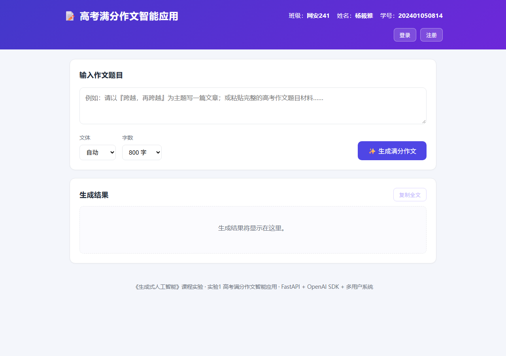
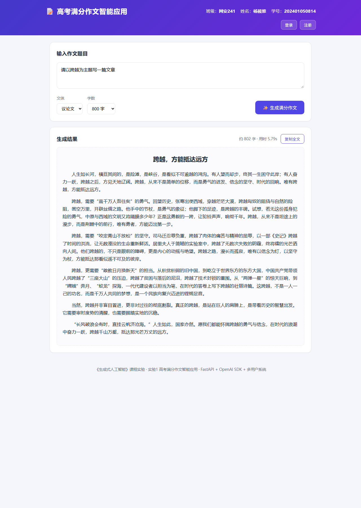
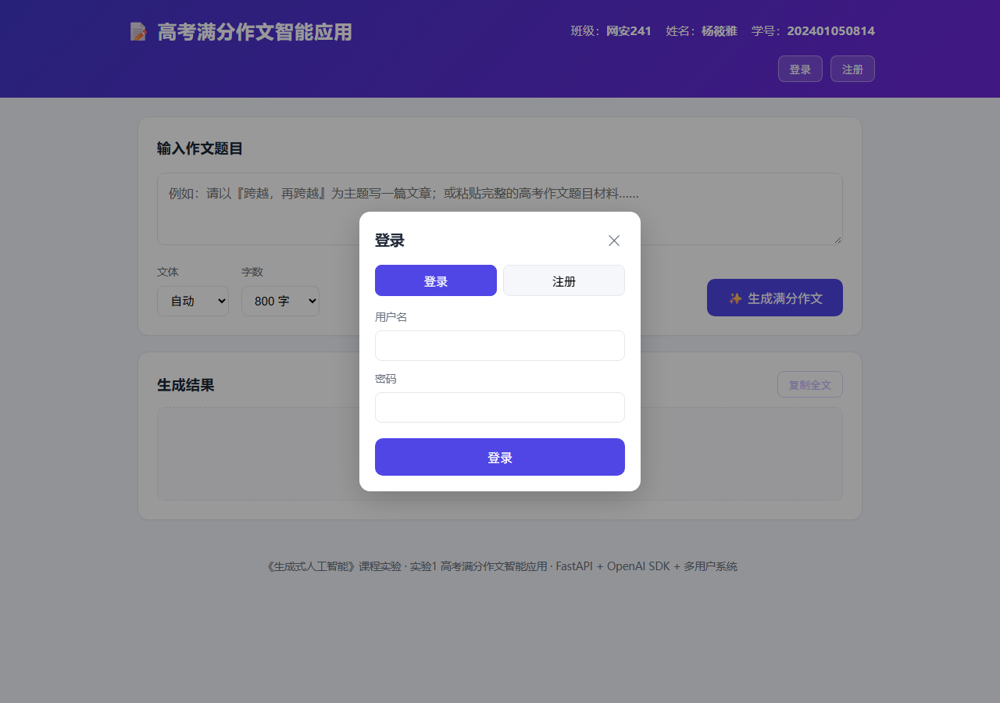

# 高考满分作文智能应用

> 《生成式人工智能》课程实验 · 实验 1 —— 高考满分作文智能应用

一个基于 **FastAPI + OpenAI SDK** 的 Web 智能应用：用户输入高考作文题目，系统调用大模型（GLM / Qwen / DeepSeek 等）自动生成一篇符合高考满分作文标准的高质量作文；并集成了**多用户信息管理系统**（注册 / 登录 / 作文历史管理），支持部署到 **Vercel + Supabase**。

---

## 一、作者信息

| 项目 | 内容 |
| --- | --- |
| 班级 | 网安241 |
| 姓名 | 杨筱雅 |
| 学号 | 202401050814 |

---

## 二、项目简介

1. **核心功能**：输入高考作文题目 → 输出一篇约 800 字的满分作文。
2. **多用户系统**：支持用户注册、登录、退出，每位用户可保存、查看、删除自己的作文历史。
3. **技术栈**：
   - 后端：`FastAPI` + `OpenAI SDK`（统一调用国内外大模型）。
   - 前端：原生 `HTML + CSS + JavaScript`。
   - 数据库：本地 `SQLite`（开箱即用）/ `Supabase`（部署到 Vercel 时）。
   - 大模型：通过 OpenAI 兼容协议调用 **GLM / Qwen / DeepSeek** 等，也可接入 **CC-SWITCH** 统一调度。
4. **提示工程**：从 20 篇历年高考满分范文样例中总结写作规律，运用角色设定、规律注入、结构化输出约束等策略设计核心提示词（见 `app/prompt.py` 与 `docs/满分作文规律总结.md`）。

---

## 三、目录结构

```
gaokao-essay-ai/
├── app/
│   ├── __init__.py
│   ├── main.py          # FastAPI 后端入口与接口（含认证、作文历史）
│   ├── llm.py           # OpenAI SDK 封装（调用大模型）
│   ├── prompt.py        # ★ 核心提示词
│   ├── security.py      # 密码哈希 + 登录令牌
│   ├── storage.py       # 数据存储层（SQLite / Supabase 双后端）
│   └── static/          # 前端（HTML/CSS/JS）
├── api/
│   └── index.py         # Vercel 部署入口（暴露 ASGI 应用）
├── supabase/
│   └── schema.sql       # Supabase 数据库建表脚本
├── docs/
│   ├── 满分作文规律总结.md
│   └── screenshots/     # 运行截图
├── scripts/md2docx.py   # README→docx 转换脚本
├── vercel.json          # Vercel 部署配置
├── requirements.txt     # 依赖清单
├── .env.example         # 环境变量示例
├── .gitignore
└── README.md            # 本文件（系统运行说明书）
```

---

## 四、环境准备与安装

### 1. 环境要求

- Python 3.9+（本项目在 3.13 上验证通过）
- 一个可用的 OpenAI 兼容大模型 API Key

### 2. 安装依赖

```bash
# 建议使用虚拟环境
python -m venv .venv
# Windows 激活
.venv\Scripts\activate
# macOS / Linux 激活
source .venv/bin/activate

# 安装依赖
pip install -r requirements.txt
```

### 3. 配置环境变量

复制 `.env.example` 为 `.env`，并填写你的配置：

```bash
cp .env.example .env   # Windows 下可手动复制重命名
```

**大模型配置**（三选一）：

| 大模型 | LLM_BASE_URL | LLM_MODEL |
| --- | --- | --- |
| DeepSeek（深度求索） | `https://api.deepseek.com` | `deepseek-chat` |
| GLM（智谱清言） | `https://open.bigmodel.cn/api/paas/v4` | `glm-4-flash` |
| Qwen（通义千问） | `https://dashscope.aliyuncs.com/compatible-mode/v1` | `qwen-plus` |

> 若使用 **CC-SWITCH** 统一调度，把 `LLM_BASE_URL` 指向其本地地址（如 `http://127.0.0.1:<端口>/v1`）即可。

**数据库配置**：

```dotenv
# 本地开发：SQLite（默认，无需额外配置）
DB_BACKEND=sqlite
DB_PATH=data/app.db

# 部署到 Vercel：改用 Supabase（详见第八节）
# DB_BACKEND=supabase
# SUPABASE_URL=你的项目URL
# SUPABASE_SERVICE_ROLE_KEY=你的service_role密钥
```

> 💡 **演示模式**：未配置 `LLM_API_KEY` 时，应用会自动进入演示模式，返回内置示例作文以便预览界面（页面会显示"演示模式"标识）。配置好密钥后即为真实大模型生成。

---

## 五、运行方法

```bash
uvicorn app.main:app --reload
```

启动后浏览器访问：

```
http://127.0.0.1:8000
```

---

## 六、功能说明与运行效果截图

### 功能 1：系统首页（含班级、姓名、学号与登录/注册入口）

首页顶部展示作者信息，右上角提供「登录 / 注册」入口；主体为「输入作文题目」卡片，可填写/粘贴作文题目、选择文体与字数。



### 功能 2：一键生成满分作文

点击「✨ 生成满分作文」按钮，后端调用大模型，返回标题 + 正文，并显示字数与耗时。未登录时仅生成（不保存）；登录后生成的同时自动保存到历史记录。



### 功能 3：复制全文

点击「复制全文」按钮，将生成的作文一键复制到剪贴板。

### 功能 4：多用户信息管理系统

**① 注册 / 登录 / 退出**：点击右上角「注册」或「登录」弹出表单，完成认证后右上角显示「欢迎，用户名」；退出后清除登录态。



**② 作文历史管理**：登录后页面底部出现「📚 我的历史记录」面板，可查看每篇作文的标题、题目、文体、字数与时间，并支持「查看」（回填到结果区）与「删除」。

> 📷【截图：我的历史记录】（登录后生成作文，页面底部即显示历史记录面板，截图即可）

### 功能 5：健康检查接口

访问 `http://127.0.0.1:8000/api/health` 返回服务状态，可用于部署后的连通性检测。

---

## 七、接口说明

### 基础接口

| 方法 | 路径 | 说明 |
| --- | --- | --- |
| GET | `/` | 返回前端首页 |
| GET | `/api/health` | 健康检查 |
| POST | `/api/generate` | 生成作文（无需登录），请求体 `{"topic","style","word_count"}` |

### 多用户认证接口

| 方法 | 路径 | 说明 |
| --- | --- | --- |
| POST | `/api/auth/register` | 注册并自动登录，返回 `{token, user}` |
| POST | `/api/auth/login` | 登录，返回 `{token, user}` |
| POST | `/api/auth/logout` | 退出登录 |
| GET | `/api/auth/me` | 获取当前登录用户信息 |

### 作文历史接口（需登录，`Authorization: Bearer <token>`）

| 方法 | 路径 | 说明 |
| --- | --- | --- |
| POST | `/api/essays` | 生成作文并保存到历史 |
| GET | `/api/essays` | 列出当前用户的作文历史（不含正文） |
| GET | `/api/essays/{id}` | 查看单篇作文详情 |
| DELETE | `/api/essays/{id}` | 删除单篇作文 |

---

## 八、部署到 Vercel + Supabase（进阶）

### 1. 创建 Supabase 数据库

1. 注册并登录 [Supabase](https://supabase.com/)，新建一个项目。
2. 打开 **SQL Editor**，粘贴并执行 [`supabase/schema.sql`](supabase/schema.sql)，创建 `users`、`sessions`、`essays` 三张表。
3. 在 **Project Settings → API** 中复制 `Project URL` 和 `service_role` 密钥。

### 2. 部署到 Vercel

1. 安装并登录 Vercel CLI：

```bash
npm i -g vercel
vercel login
```

2. 在项目根目录执行部署：

```bash
vercel
```

3. 在 Vercel 项目 **Settings → Environment Variables** 中配置以下变量：

| 变量 | 值 |
| --- | --- |
| `LLM_API_KEY` | 你的大模型密钥 |
| `LLM_BASE_URL` | 大模型接口地址 |
| `LLM_MODEL` | 模型名称 |
| `DB_BACKEND` | `supabase` |
| `SUPABASE_URL` | Supabase 项目 URL |
| `SUPABASE_SERVICE_ROLE_KEY` | Supabase service_role 密钥 |

4. 重新部署使其生效：`vercel --prod`，访问 Vercel 分配的域名即可。

> 说明：本项目已提供 `vercel.json` 与 `api/index.py`，Vercel 会自动识别 FastAPI（ASGI）应用。部署前建议先用 `vercel dev` 本地验证。`SUPABASE_SERVICE_ROLE_KEY` 拥有完全权限，仅用于服务端，切勿写入前端代码或提交到公开仓库。

---

## 九、核心提示词

完整核心提示词见 [`app/prompt.py`](app/prompt.py)，其设计依据见 [`docs/满分作文规律总结.md`](docs/满分作文规律总结.md)。

**要点**：通过「角色设定（高考阅卷专家）+ 满分作文规律注入（标题/开头/结构/论据/语言/立意/结尾七项约束）+ 结构化输出约束（只输出作文本身）」三重策略，控制大模型输出高质量的满分作文。

---

## 十、提交物清单

| 序号 | 提交物 | 说明 |
| --- | --- | --- |
| 1 | GitHub 仓库地址 | 本项目完整代码 |
| 2 | `README.md` 转换的 docx | 系统运行说明书 |
| 3 | 核心提示词 | `app/prompt.py` 与 `docs/满分作文规律总结.md` |

### 将 README 转换为 docx

推荐使用 [Pandoc](https://pandoc.org/)：

```bash
pandoc README.md -o 系统运行说明书.docx
```

或直接运行仓库内置脚本（已生成在项目根目录）：

```bash
python scripts/md2docx.py README.md 系统运行说明书.docx
```

### 推送到 GitHub

```bash
git init
git add .
git commit -m "feat: 高考满分作文智能应用（多用户 + Vercel/Supabase 部署）"
git branch -M main
git remote add origin https://github.com/<你的用户名>/<仓库名>.git
git push -u origin main
```

> 注意：`.env` 已在 `.gitignore` 中排除，API 密钥不会被提交到仓库。
